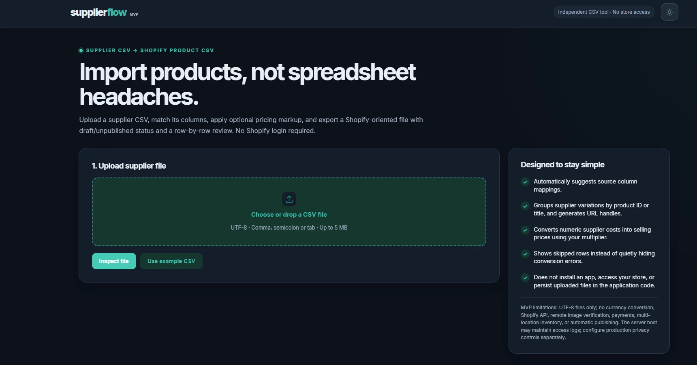

# SupplierFlow Studio

**From the first MVP to a better way to prepare supplier catalogs.**

See how SupplierFlow has changed through real screenshots and short release notes.

[**View the visual website**](https://esatworks.github.io/supplierflow-showcase/) · [**Version history**](docs/releases/)

---

## How it started

SupplierFlow began with a simple goal: turn supplier CSV files into product data that is easier to import into Shopify. What started as a basic upload page slowly became a more complete tool.

### Initial MVP — The first screen

A clean, light design focused on uploading a file and getting started.

[Read about the first MVP](docs/releases/initial-mvp.md)

### MVP — Exploring a dark theme

We tried a darker look while keeping the simple upload flow.

[Read about the dark theme](docs/releases/mvp-dark.md)

### v1.4 — More control over exports

This version made it easier to choose between draft and active products in the exported CSV. It did not connect directly to a Shopify store.

[Read v1.4 notes](docs/releases/v1.4.md)

### v1.8.2 — A new Studio look

The upload area, steps and publishing options came together in a more complete interface.

[Read v1.8.2 notes](docs/releases/v1.8.2.md)

### v1.9.0 — A more reliable experience

We focused on smoother file uploads, repeat conversions, page reloads and account checks. This release was tested for private, local use.

**Automated tests:** 197 run, 196 passed, 1 skipped.

A v1.9.0 screenshot has not been added yet. The latest screenshot shown here is from v1.8.2.

[Read v1.9.0 notes](docs/releases/v1.9.0.md)

---

SupplierFlow is an independent project. It is not affiliated with Shopify. The full application is not published in this showcase.
