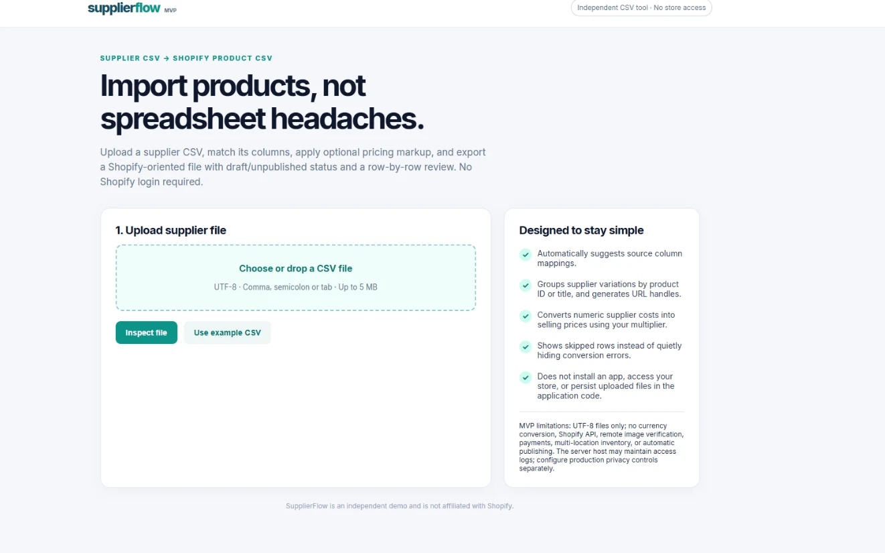

# Initial MVP

SupplierFlow started with a simple upload page. The idea was to take a supplier CSV, match its columns and create a Shopify-ready CSV file.

This screenshot shows the original design, not a live version of the app.

[Back to version history](README.md)
