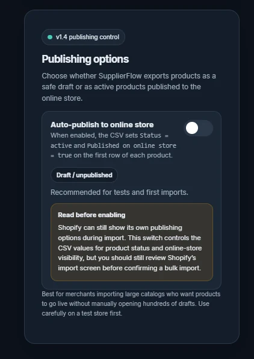

# v1.4 — Publishing options

The export screen made the choice between draft and active products easier to understand. This setting changes the exported CSV; it does not publish products directly to a Shopify store.

[Back to version history](README.md)
