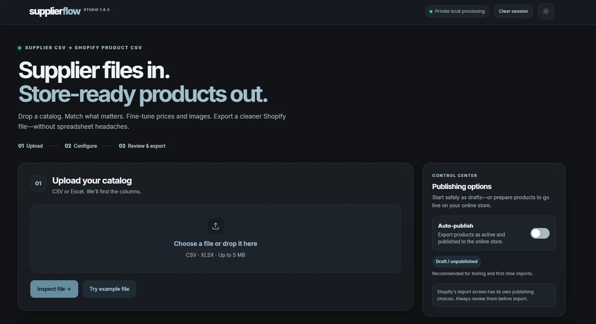

# v1.8.2 — Studio interface

The design became more organised, with a clear upload area, steps to follow and publishing options in one place.

This was a private local test version, not a public online service.

[Back to version history](README.md)
